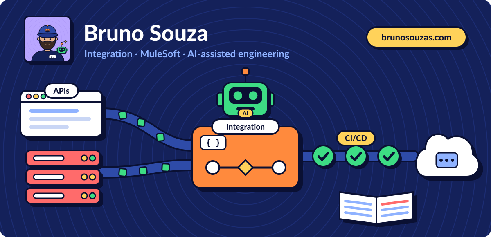
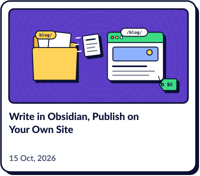
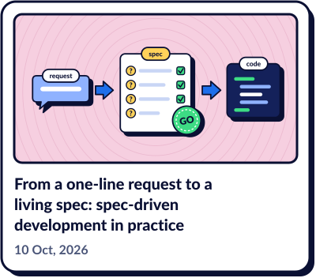
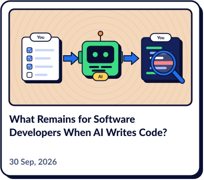
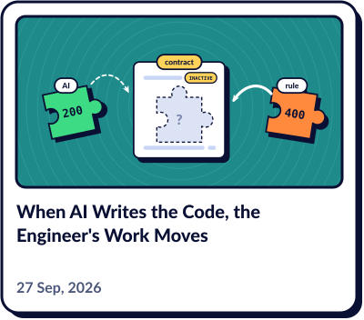

### Latest articles

<!-- articles:start -->
<a href="https://brunosouzas.com/blog/write-in-obsidian-publish-on-your-site/"><picture><source media="(prefers-color-scheme: dark)" srcset="assets/articles/write-in-obsidian-publish-on-your-site-dark.svg"></picture></a>
<a href="https://brunosouzas.com/blog/spec-driven-development-in-practice/"><picture><source media="(prefers-color-scheme: dark)" srcset="assets/articles/spec-driven-development-in-practice-dark.svg"></picture></a>
<a href="https://brunosouzas.com/blog/ai-writes-code/"><picture><source media="(prefers-color-scheme: dark)" srcset="assets/articles/ai-writes-code-dark.svg"></picture></a>
<a href="https://brunosouzas.com/blog/where-the-work-moves/"><picture><source media="(prefers-color-scheme: dark)" srcset="assets/articles/where-the-work-moves-dark.svg"></picture></a>
<!-- articles:end -->

<a href="https://brunosouzas.com/blog/"><picture><source media="(prefers-color-scheme: dark)" srcset="assets/link-articles-dark.svg"></picture></a>

### Find me

<a href="https://brunosouzas.com/"><picture><source media="(prefers-color-scheme: dark)" srcset="assets/link-site-dark.svg"></picture></a>
<a href="https://www.linkedin.com/in/brunosouzas"><picture><source media="(prefers-color-scheme: dark)" srcset="assets/link-linkedin-dark.svg"></picture></a>
<a href="mailto:brunosouzas@gmail.com"><picture><source media="(prefers-color-scheme: dark)" srcset="assets/link-email-dark.svg"></picture></a>
