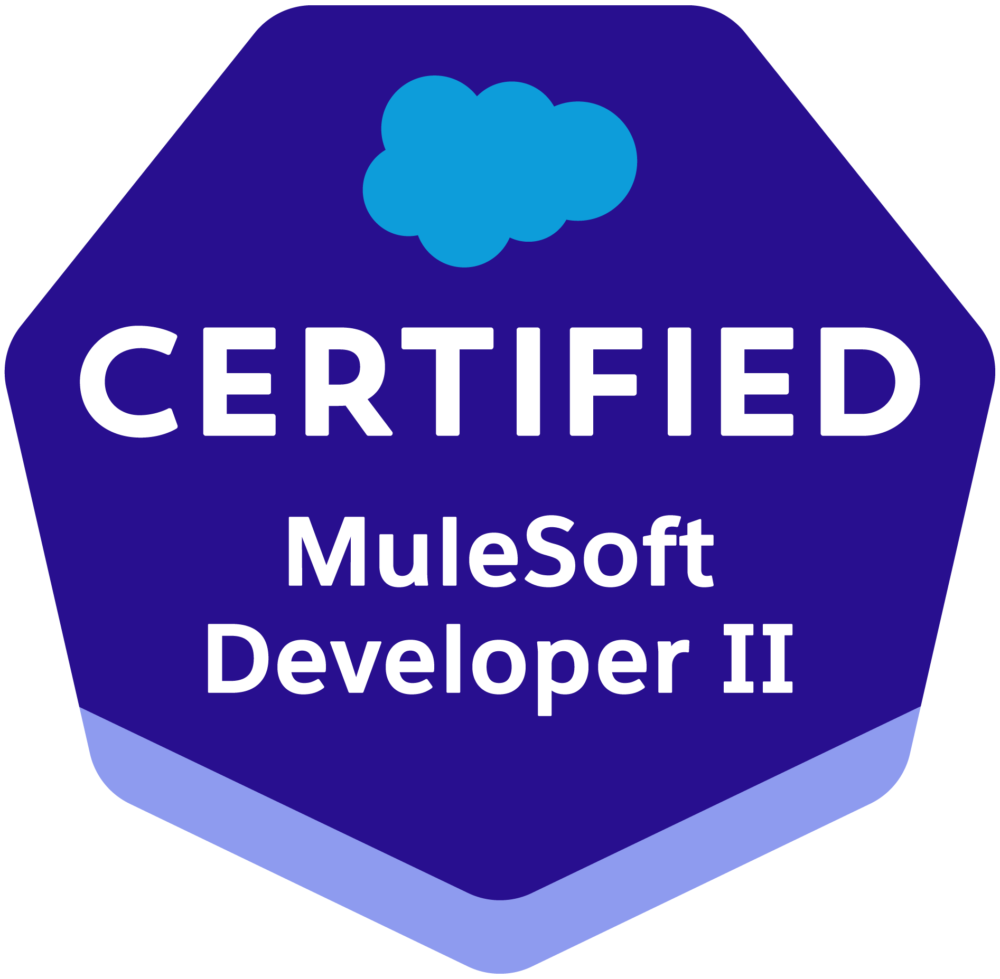
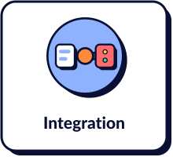
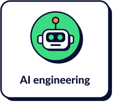
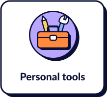

I'm an integration architect. I work with MuleSoft, APIs and CI/CD, and outside work I study how to use AI agents in software development.

I write about what happens between systems on **[brunosouzas.com](https://brunosouzas.com/)**: I take an idea everyone repeats, such as SOLID, retries or GitFlow, and see what is left of it once it meets a real Mule application. When an article has code, it is public on GitHub and tested; the table below lists it.

 

### What I write about

<a href="https://brunosouzas.com/categories/integration"><picture><source media="(prefers-color-scheme: dark)" srcset="assets/topic-integration-dark.svg"></picture></a>
<a href="https://brunosouzas.com/categories/delivery"><picture><source media="(prefers-color-scheme: dark)" srcset="assets/topic-delivery-dark.svg"></picture></a>
<a href="https://brunosouzas.com/categories/ai-engineering"><picture><source media="(prefers-color-scheme: dark)" srcset="assets/topic-ai-engineering-dark.svg"></picture></a>
<a href="https://brunosouzas.com/categories/personal-tools"><picture><source media="(prefers-color-scheme: dark)" srcset="assets/topic-personal-tools-dark.svg"></picture></a>

### Latest articles

<!-- articles:start -->
- [Write in Obsidian, Publish on Your Own Site](https://brunosouzas.com/blog/write-in-obsidian-publish-on-your-site/) · 15 Oct, 2026
- [From a one-line request to a living spec: spec-driven development in practice](https://brunosouzas.com/blog/spec-driven-development-in-practice/) · 10 Oct, 2026
- [What Remains for Software Developers When AI Writes Code?](https://brunosouzas.com/blog/ai-writes-code/) · 30 Sep, 2026
- [When AI Writes the Code, the Engineer's Work Moves](https://brunosouzas.com/blog/where-the-work-moves/) · 27 Sep, 2026
- [Circuit Breaker in MuleSoft: When Retry Makes Things Worse](https://brunosouzas.com/blog/circuit-breaker-in-mulesoft/) · 25 Sep, 2026
<!-- articles:end -->

[All articles →](https://brunosouzas.com/blog)

### Code from the articles

| Repository | What it is | Read |
|---|---|---|
| [mule4-circuit-breaker](https://github.com/brunosouzas/mule4-circuit-breaker) | Circuit breaker plugin for Mule 4, with state shared across replicas | [Circuit Breaker in MuleSoft](https://brunosouzas.com/blog/circuit-breaker-in-mulesoft) |
| [mulesoft-solid-examples](https://github.com/brunosouzas/mulesoft-solid-examples) | Runnable before/after examples of the SOLID principles in Mule 4, with MUnit tests | [SOLID in MuleSoft](https://brunosouzas.com/blog/series/solid-in-mulesoft) |
| [azure-devops-mulesoft-pipelines](https://github.com/brunosouzas/azure-devops-mulesoft-pipelines) | Azure Pipelines templates: GitFlow, maven-release-plugin and CloudHub 2.0 deployments with approvals | [Delivering MuleSoft applications with Azure DevOps](https://brunosouzas.com/blog/series/mulesoft-delivery-azure-devops) |
| [mulesoft-orders-api](https://github.com/brunosouzas/mulesoft-orders-api) | Reference Mule 4 app delivered by those pipelines | [Delivering MuleSoft applications with Azure DevOps](https://brunosouzas.com/blog/series/mulesoft-delivery-azure-devops) |
| [spec-driven-delivery-api](https://github.com/brunosouzas/spec-driven-delivery-api) | A Mule 4 API built spec-first with OpenSpec, then evolved through a delta | [Spec-driven development in practice](https://brunosouzas.com/blog/spec-driven-development-in-practice) |
| [ai-assisted-engineering-lab](https://github.com/brunosouzas/ai-assisted-engineering-lab) | Synthetic Mule 4 lab for reproducible AI-assisted engineering exercises | [When AI Writes the Code, the Engineer's Work Moves](https://brunosouzas.com/blog/where-the-work-moves) |

### Find me

<a href="https://brunosouzas.com/"><picture><source media="(prefers-color-scheme: dark)" srcset="assets/link-site-dark.svg"></picture></a>
<a href="https://www.linkedin.com/in/brunosouzas"><picture><source media="(prefers-color-scheme: dark)" srcset="assets/link-linkedin-dark.svg"></picture></a>
<a href="mailto:brunosouzas@gmail.com"><picture><source media="(prefers-color-scheme: dark)" srcset="assets/link-email-dark.svg"></picture></a>

Artwork from <a href="https://brunosouzas.com/">brunosouzas.com</a>. The latest articles refresh daily from the site's <a href="https://brunosouzas.com/rss.xml">RSS feed</a>; <a href="scripts/">scripts/</a> builds the images and the list.
